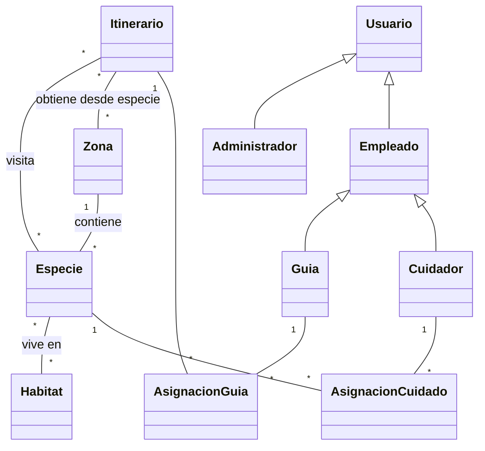

# GrupoCTema12 - Sistema de gestion de Mundo Marino

Implementacion orientada a objetos del enunciado, en Java 21 y sin dependencias externas. Se puede abrir directamente desde NetBeans como un proyecto Java con Ant y ejecutar la clase `grupoctema12.GrupoCTema12`.

## Analisis y objetos del dominio

| Objeto | Atributos principales | Comportamiento |
|---|---|---|
| `Especie` | nombre espanol, nombre cientifico, descripcion, habitats, zona | Agregar habitat y cambiar su zona. |
| `Habitat` | nombre, clima, vegetacion, continentes | Asociar especies. |
| `Zona` | nombre, extension, especies, itinerarios | Alojar especies y formar parte de itinerarios. |
| `Itinerario` | codigo, duracion, longitud, aforo, especies, zonas | Anadir especies y obtener automaticamente sus zonas. |
| `Guia` | datos personales, fecha de ingreso, asignaciones | Consultar sus propias asignaciones. |
| `Cuidador` | datos personales, fecha de ingreso, responsabilidades | Consultar las especies a su cargo. |
| `AsignacionGuia` | guia, itinerario, hora | Representar la relacion guia--itinerario con su hora. |
| `AsignacionCuidado` | cuidador, especie, fecha | Representar la relacion cuidador--especie con su fecha. |
| `Administrador` | usuario, nombre | Registrar y administrar toda la informacion. |
| `SistemaMundoMarino` | colecciones de todos los objetos | Aplicar permisos y coordinar las relaciones. |

`Empleado` y `Usuario` son abstracciones para evitar repetir los datos comunes y distinguir los tres roles: administrador, guia y cuidador.

## Relaciones e interacciones

Las relaciones muchos-a-muchos que tienen un dato propio no se guardan como una simple lista: `AsignacionGuia` conserva la hora y `AsignacionCuidado` conserva la fecha. Cada itinerario guarda las especies que visita; al agregar una especie se agrega automaticamente la zona en la que esta ubicada. Esto evita recorridos con zonas sin animales seleccionados.

## Permisos

- El administrador registra, vincula y consulta todos los elementos.
- Un guia puede consultar exclusivamente su perfil y los itinerarios que tiene asignados.
- Un cuidador puede consultar exclusivamente su perfil y las especies de las que esta a cargo.

`SistemaMundoMarino` usa `ControlAcceso` antes de ejecutar las operaciones protegidas. Cualquier acceso no autorizado produce una `SecurityException`.

## Menu y persistencia

Al ejecutar `GrupoCTema12` se muestra un menu principal con tres perfiles.

- **Administrador:** puede registrar y modificar especies, habitats, zonas, itinerarios, guias y cuidadores. Al crear un itinerario indica un numero de 1 a 99 y el sistema genera el codigo `IT-XX`. No puede guardarlo hasta asignar una especie. Cada especie agrega automaticamente su propia zona al recorrido; no existe una opcion para agregar zonas solas.
- **Guia:** ingresa con su nombre de usuario y consulta solamente sus datos, horarios, itinerarios, zonas y especies visitadas.
- **Cuidador:** ingresa con su nombre de usuario y consulta solamente sus datos, especies asignadas, fecha de responsabilidad, zona, habitats y demas cuidadores de cada especie.

Los datos se guardan automaticamente, sin base de datos, en el archivo `datos_mundo_marino.dat` mediante serializacion de objetos. Al volver a ejecutar el programa, ese archivo se carga antes de mostrar el menu. Los datos de demostracion incluyen el guia `guia.lucia` y el cuidador `cuidador.diego`.

La solucion usa **encapsulamiento** (atributos privados y operaciones controladas), **abstraccion** (`Usuario` y `Empleado`), **herencia** (`Guia` y `Cuidador` heredan de `Empleado`), **polimorfismo** (el menu opera con referencias `Empleado`/`Usuario`) y **persistencia** basada en archivos.
